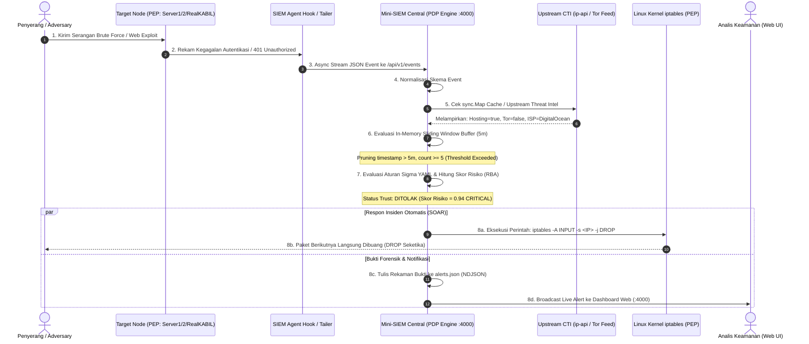

# 🛡️ Catatan Riset: Mini-SIEM Ultra-Lightweight Berbasis Golang dengan Pendekatan Zero Trust Telemetry & Dynamic Containment

Dokumen ini memuat formulasi fokus utama Tugas Akhir (TA), landasan filosofis Zero Trust Architecture (NIST SP 800-207), perancangan arsitektur Policy Decision Point (PDP) & Policy Enforcement Point (PEP), alur kerja dynamic containment, pemetaan riset gap, serta skenario pengujian komparatif untuk sidang sarjana terapan / diploma.

---

## 📌 1. Identitas & Rekomendasi Judul Resmi

### 🏆 Rekomendasi Utama (Fokus Terpilih: 15 Kata - Ringkas & Sesuai Batas Kampus):
* **Judul Bahasa Indonesia (Resmi):**
  > *"Rancang Bangun Lightweight SIEM Berbasis Golang Menggunakan Sliding Window dan Sigma Rules dengan Evaluasi Performa"*
* **Jumlah Kata:** **15 kata** (Di bawah batas maksimal 20 kata).
* **Judul Bahasa Inggris (Official):**
  > *"Design of a Lightweight Golang SIEM Using Sliding Window and Sigma Rules with Performance Evaluation"* (15 kata).
* **Klasifikasi Bidang:** Rekayasa Keamanan Siber (*Cybersecurity Engineering*), Deteksi Intrusi & Log Analytics, dan Evaluasi Kinerja Sistem (*System Performance Benchmarking*).

---

### 📚 Rekomendasi Opsi Judul Lengkap Lainnya (Berdasarkan Fokus Spesifik Riset)

Jika dosen pembimbing menyarankan penyesuaian sudut pandang teknis, berikut adalah seluruh 8 opsi judul alternatif yang telah dirumuskan lengkap dalam Bahasa Indonesia dan Bahasa Inggris:

#### 🔹 Opsi 1: Fokus Algoritma & Rule Engine
* **🇮🇩 Bahasa Indonesia:**
  > *"Rancang Bangun Mini-SIEM Berbasis Golang Menggunakan Algoritma Sliding Window dan Rule Engine Standar Sigma untuk Deteksi Dini Serangan Otentikasi"*
* **🇬🇧 Bahasa Inggris:**
  > *"Design and Implementation of a Lightweight Golang-Based Mini-SIEM with Sliding Window Event Correlation and Sigma Rule Engine"*
* **Fokus Riset:** Menguji keandalan stateful correlation *Sliding Window* dalam menangani batas waktu kaku (*boundary window*) serta parsing deklaratif format Sigma HQ YAML.

#### 🔹 Opsi 2: Fokus Arsitektur Terdistribusi & Threat Intelligence
* **🇮🇩 Bahasa Indonesia:**
  > *"Implementasi Sistem SIEM Terdistribusi Berbasis Microservices dengan Pengayaan Cyber Threat Intelligence dan Korelasi Log Real-Time"*
* **🇬🇧 Bahasa Inggris:**
  > *"Real-Time Security Event Ingestion and Upstream Threat Intelligence Enrichment for Distributed Microservice Environments"*
* **Fokus Riset:** Menyoroti transmisi log antar-service heterogen dan pengayaan intelijen ancaman IP di lapisan aliran data (*stream*).

#### 🔹 Opsi 3: Fokus Komprehensif & Containerization
* **🇮🇩 Bahasa Indonesia:**
  > *"Sistem Deteksi Ancaman Keamanan Berbasis Rule Engine Sigma dan Upstream Log Enrichment Menggunakan Arsitektur Agent-Server pada Lingkungan Container"*
* **🇬🇧 Bahasa Inggris:**
  > *"A Vendor-Agnostic Lightweight SIEM Architecture Using Sigma Rules and In-Memory Sliding Window Correlation"*
* **Fokus Riset:** Rancang bangun menyeluruh dari forwarder agent, collector gateway, hingga web dashboard terisolasi dalam container Docker.

#### 🔹 Opsi 4: Fokus Efisiensi Resource & Benchmark Komparatif (vs Wazuh / ELK)
* **🇮🇩 Bahasa Indonesia:**
  > *"Rancang Bangun SIEM Ultra-Lightweight Berbasis Golang dengan Evaluasi Throughput dan Efisiensi Memori pada Lingkungan Resource-Constrained"*
* **🇬🇧 Bahasa Inggris:**
  > *"Design of an Ultra-Lightweight Golang SIEM with Throughput and Memory Efficiency Evaluation in Resource-Constrained Environments"*
* **Fokus Riset:** Pengujian kuantitatif performa CPU, memori RAM (<80MB vs 4-8GB pada Wazuh/Elasticsearch), dan kapasitas Events Per Second (EPS).

#### 🔹 Opsi 5: Fokus Risk-Based Alerting (RBA) & Reduksi Alert Fatigue
* **🇮🇩 Bahasa Indonesia:**
  > *"Penerapan Model Continuous Risk-Based Alerting pada Mini-SIEM Golang untuk Mereduksi Alert Fatigue Pemantauan Server"*
* **🇬🇧 Bahasa Inggris:**
  > *"Implementing Continuous Risk-Based Alerting in a Golang Mini-SIEM to Mitigate Alert Fatigue in Server Monitoring"*
* **Fokus Riset:** Penerapan 5 formula hipotesis risiko (Severity, Accumulation, Variety, Rarity, Aperiodicity) merujuk riset Fraunhofer FKIE untuk memfilter alarm palsu (*False Positives*).

#### 🔹 Opsi 6: Fokus Respon Insiden Otomatis (SOAR) & Active Defense
* **🇮🇩 Bahasa Indonesia:**
  > *"Integrasi Mini-SIEM dan Respon Insiden Otomatis Berbasis Dynamic Firewall Rule untuk Mitigasi Serangan Brute Force Real-Time"*
* **🇬🇧 Bahasa Inggris:**
  > *"Integrating Mini-SIEM and Dynamic Firewall-Based Automated Incident Response for Real-Time Brute Force Mitigation"*
* **Fokus Riset:** Siklus penuh penanganan insiden (NIST SP 800-61): deteksi dini hingga eksekusi otomatis pemblokiran kernel `iptables` di container target.

#### 🔹 Opsi 7: Fokus Upstream CTI & Reputasi IP Anomali
* **🇮🇩 Bahasa Indonesia:**
  > *"Sistem Deteksi Anomali Autentikasi Berbasis Upstream Threat Intelligence Enrichment dan Reputasi IP pada Arsitektur Terdistribusi"*
* **🇬🇧 Bahasa Inggris:**
  > *"Authentication Anomaly Detection System Based on Upstream Threat Intelligence Enrichment and IP Reputation in Distributed Architectures"*
* **Fokus Riset:** Percepatan Mean Time to Detect (MTTD 40%) melalui deteksi instan IP Datacenter/Hosting, Tor Exit Node, dan Proxy di memori sebelum korelasi.

#### 🔹 Opsi 8: Fokus Telemetri Log Audit & Web AppSec Multi-Container
* **🇮🇩 Bahasa Indonesia:**
  > *"Sentralisasi Telemetri Log Audit dan Deteksi Serangan Web Menggunakan Arsitektur Agent-Collector Golang pada Klaster Multi-Container"*
* **🇬🇧 Bahasa Inggris:**
  > *"Centralized Audit Log Telemetry and Web Attack Detection Using a Golang Agent-Collector Architecture on Multi-Container Clusters"*
* **Fokus Riset:** Agregasi log audit aplikasi web nyata (Laravel 11 `RealKABIL` & service Go) untuk mendeteksi serangan web (SQL Injection, XSS, Unauthorized Access).

---

## 🏛️ 2. Landasan Filosofis: Zero Trust Architecture (NIST SP 800-207)

Sistem SIEM konvensional mengandalkan model keamanan berbasis perimeter tradisional (*Castle-and-Moat*): lalu lintas internal di dalam jaringan dianggap aman setelah pengguna melewati firewall luar atau berhasil login pertama kali. Model ini terbukti gagal menghadapi ancaman kredensial curian (*credential stuffing*), pergerakan lateral (*lateral movement*), dan penyerang dari dalam (*insider threat*).

Sistem Mini-SIEM ini mengadopsi standar **NIST Special Publication 800-207 (Zero Trust Architecture)** dengan prinsip operasional:

### 🔹 Prinsip Inti yang Diterapkan:
1. **Never Trust, Always Verify (Verifikasi Berkelanjutan):**
   - Keberhasilan autentikasi awal (password benar) tidak menjamin akses aman seterusnya.
   - Sistem terus mengevaluasi setiap interaksi: apakah request berasal dari IP Datacenter/Hosting (AWS/DO), apakah user-agent berubah drastis, apakah terjadi anomali geolokasi (*Impossible Travel*), atau frekuensi request melonjak tidak wajar.
2. **Separation of PDP and PEP:**
   - **Policy Decision Point (PDP):** Berada di **Pusat Mini-SIEM (`siem-central:4000`)**. Menerima telemetri, mengevaluasi aturan Sigma YAML, menghitung skor risiko (Risk-Based Alerting), dan memutuskan status kelayakan trust suatu entitas.
   - **Policy Enforcement Point (PEP):** Berada di **Node Target (`target-server1`, `target-server2`, `target-realkabil`)**. Bertindak sebagai penegak kebijakan; menolak akses atau memblokir paket penyerang di level interface kernel Linux via `iptables`.
3. **Least Privilege & Inter-Service Audit:**
   - Setiap transmisi antar-service (misal: Server 1 Auth menuju Server 2 Resource) diaudit ketat. Percobaan akses ke endpoint terlarang (HTTP 403) langsung menurunkan skor reputasi entitas.

---

## ⚡ 3. Arsitektur Ultra-Lightweight (<80MB RAM) untuk Server Terbatas

### 🔍 Masalah Nyata di Industri & Usaha Kecil/Menengah (SME):
- Solusi SIEM pasar (Wazuh, Elastic SIEM, Splunk) membutuhkan infrastruktur komputasi masif: JVM Java Heap 4–8 GB RAM, cluster database terdistribusi, dan beberapa daemon terpisah (Elasticsearch + Logstash/Filebeat + Kibana).
- Organisasi dengan server berdaya rendah (Edge VPS 1 vCPU / 512MB RAM, router industri, atau container mikro) tidak mampu mengoperasikan SIEM tersebut tanpa mengalami *Out-of-Memory (OOM Crash)*.

### 💡 Solusi Rekayasa Proyek Ini:
1. **Single Compiled Binary Golang:**
   - Seluruh subsistem (Event Collector, Normalizer, Threat Intel Caching, Sliding Window Engine, Sigma Evaluator, Embedded Web UI) dikompilasi menjadi satu file binary native Linux tanpa virtual machine atau runtime interpreter.
2. **In-Stream Pre-Storage Processing:**
   - Evaluasi log dilakukan 100% di memori RAM menggunakan konkurensi native Go (Goroutines, Buffered Channels, dan `sync.Map`).
   - Disk database relasional dieliminasi; log hanya ditulis ke disk saat ada insiden terkonfirmasi (`alerts.json`), menghilangkan *disk I/O bottleneck*.
3. **Memory Footprint Minimal:**
   - Konsumsi RAM saat idle: ~20–35 MB.
   - Konsumsi RAM saat beban puncak (1.000 EPS): < 80 MB.

---

## 🔄 4. Alur Kerja End-to-End: Zero Trust Telemetry & Dynamic Containment

### 📋 Tahapan Alur Kerja Rinci:
1. **Telemetri Tanpa Beban (Non-Blocking):** Target node mencatat event keamanan dan mendistribusikannya via background channel Go agar performa aplikasi web tidak terhambat.
2. **Upstream In-Memory Enrichment:** Sebelum aturan dievaluasi, reputasi IP diperkaya seketika di memori RAM (pencarian cache `<1µs`). IP penyerang yang berasal dari hosting cloud langsung mendapat penanda kecurigaan tinggi.
3. **Evaluasi Waktu Dinamis (Sliding Window):** Menghindari kelemahan *fixed window*, memantau frekuensi serangan secara kontinu dalam rentang bergerak $[T - 5\text{m}, T]$.
4. **Dynamic Containment (Pemutusan Akses Otomatis):** SIEM bertindak sebagai orkestrator respons: menerbitkan perintah blokir firewall pada tingkat kernel container target, memutus serangan dalam hitungan milidetik secara otonom (*Closed-Loop Mitigation*).

---

## 📊 5. Skenario Pengujian & Metrik Evaluasi untuk Sidang TA

Untuk membuktikan kebaruan dan efektivitas sistem di hadapan dosen penguji, dilakukan 3 skenario pengujian terukur:

### 🔹 Skenario A: Uji Efisiensi Sumber Daya (Benchmarking vs Wazuh)
* **Tujuan:** Membuktikan klaim *ultra-lightweight* pada server terbatas.
* **Instrumen:** Docker stats & `psrecord` memantau container `siem-central` vs container `wazuh-manager + opensearch`.
* **Metrik:**
  - Memory Footprint (RAM Idle & RAM Peak dalam MB).
  - CPU Utilization (% per 500 EPS).
  - Binary/Image Size (MB).

### 🔹 Skenario B: Uji Akurasi Deteksi & Latensi Korelasi
* **Tujuan:** Memvalidasi akurasi *Sliding Window* dan *Sigma Rule Engine*.
* **Instrumen:** Simulasi serangan brute force (Hydra / Scapy) dengan variasi laju: *Fast Attack* (50 req/s), *Moderate* (5 req/s), dan *Slow-and-Low* (1 req/menit).
* **Metrik:**
  - True Positive Rate (TPR / Recall) & False Positive Rate (FPR).
  - Precision & F1-Score.
  - Correlation Latency (waktu dari event diterima hingga rule match).

### 🔹 Skenario C: Uji Respon Insiden Otomatis (Dynamic Containment)
* **Tujuan:** Mengukur kecepatan isolasi penyerang (NIST SP 800-61).
* **Instrumen:** Attacker melancarkan 10 percobaan login gagal; mengukur pada percobaan ke berapa koneksi TCP diputus oleh `iptables`.
* **Metrik:**
  - Mean Time to Remediate (MTTR dalam milidetik).
  - Paket Drop Rate (%) setelah isolasi aktif.

---

## 📁 6. Struktur Direktori Terkait

* Catatan ini: `catatan/01_fokus_zero_trust_dan_arsitektur_ta.md`
* Kajian Literatur 15 Jurnal: `catatan/02_catatan_literatur_dan_judul_ta.md`
* Rencana Implementasi: `catatan/03_rencana_implementasi_siem.md`
* Diagram Visual: `catatan/diagram/`
* Naskah Word & PDF: `catatan/proposal/`
