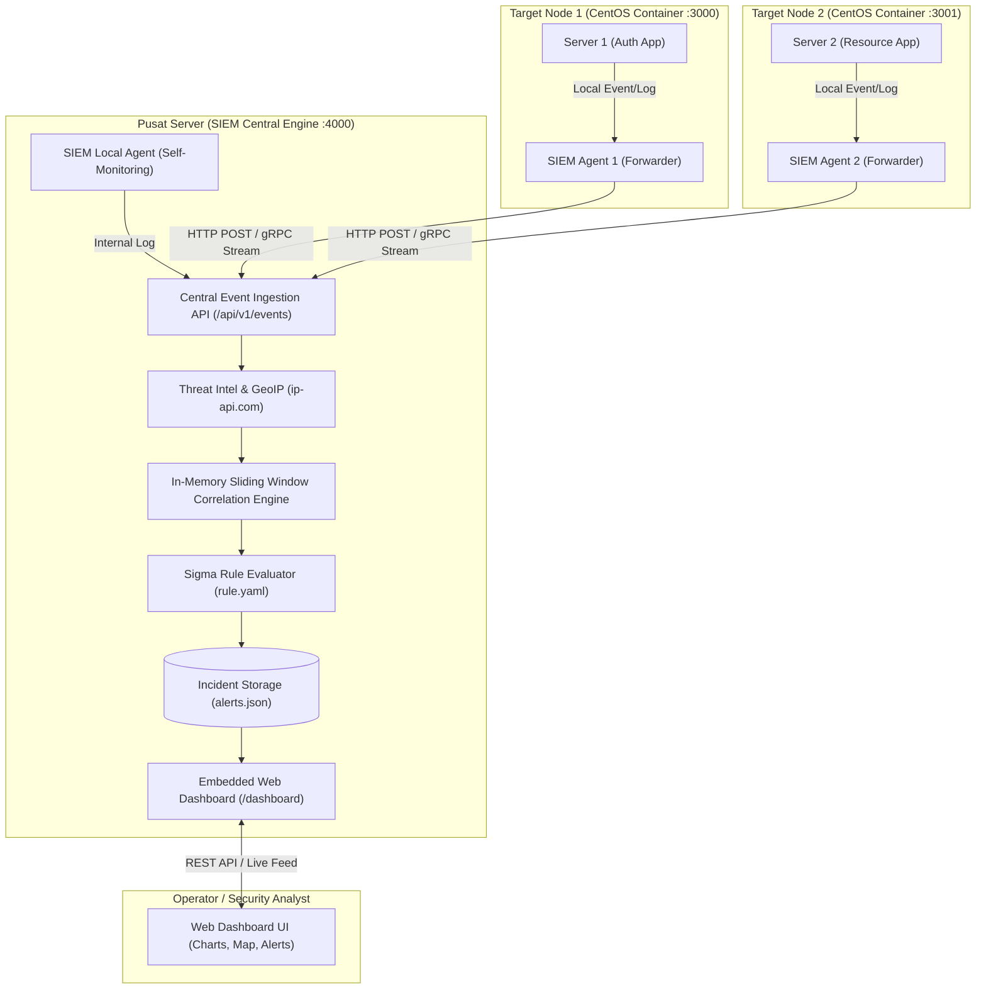

# Perancangan & Rencana Implementasi Mini-SIEM (Golang)

Dokumen ini memuat perancangan arsitektur, pola arsitektur **Agent-Server (Forwarder-Collector)** berbasis Docker CentOS, konsep mekanisme **Sliding Window Buffer**, rancangan **Web Dashboard (Single Binary)**, opsi integrasi AI, serta rencana tahapan implementasi sistem **Mini-SIEM (Security Information and Event Management)** berbasis Golang untuk Tugas Akhir (TA).

---

## 📌 1. Latar Belakang & Tujuan Sistem

Mini-SIEM dirancang untuk mengumpulkan, menormalisasi, memperkaya (*enrichment*), dan menganalisis log keamanan dari target service (`server1`, `server2`, atau data log historis) secara terpusat untuk mendeteksi ancaman keamanan berbasis aturan (*rule-based detection*).

### 🎯 Tujuan Utama:
1. **Log Ingestion (Pola Agent-Server):** Menerima event keamanan dari target service via Agent (Sidecar atau Middleware SDK) ke Pusat SIEM.
2. **Log Normalization:** Menyeragamkan format log yang masuk ke dalam skema standar *Normalized Security Event*.
3. **Log Enrichment:** Memperkaya informasi IP asal menggunakan Threat Intelligence & Geolocation ([services/ipapi.go](file:///c:/Users/mixto/Documents/MyCodeMyBackup/golang/TA/services/ipapi.go)) untuk mendeteksi Datacenter/Hosting/Proxy.
4. **Rule & Correlation Engine (Sliding Window):** Mengevaluasi log terhadap aturan di [rule.yaml](file:///c:/Users/mixto/Documents/MyCodeMyBackup/golang/TA/rule.yaml) berbasis standar **Sigma Rules** menggunakan *sliding time window* (misal: Failed login > 5 dalam 5 menit).
5. **Alerting & Incident Logging:** Merekam dan menampilkan insiden keamanan terdeteksi secara terstruktur (`alerts.json` / Terminal Console / REST API).
6. **Web Dashboard Interaktif:** Menampilkan metrik serangan, geolocation map, dan live incident alert secara visual.
7. **AI SOC Assistant (Next-Gen):** Analisis ancaman otomatis dan rekomendasi mitigasi berbasis LLM.

---

## 🏢 2. Arsitektur Agent-Server & Docker Virtualization (CentOS)

Sistem dirancang menggunakan pola **Forwarder-Collector Pattern** yang dapat dijalankan secara terdistribusi di Docker menggunakan base image enterprise **CentOS Stream 9** (atau Rocky Linux 9):



### 💡 Konsep Penempatan Agent:
1. **Cara Sidecar / Background Daemon:** File binary `siem-agent` berjalan di background OS Linux/CentOS membaca file log lokal dan mengirimkan ke Pusat SIEM (`SIEM_CENTRAL_URL=http://siem-central:4000/api/v1/events`).
2. **Cara Middleware SDK:** Dipasang langsung di router aplikasi Go (Fiber middleware) untuk otomatis mengirim event saat autentikasi gagal/berhasil.

### 🐳 Konfigurasi Multi-Node Docker (`docker-compose.yml`):
```yaml
version: '3.8'

services:
  siem-central:
    image: quay.io/centos/centos:stream9
    container_name: siem-central
    ports:
      - "4000:4000" # Web Dashboard & Event Ingestion
    networks:
      siem-network:
        ipv4_address: 172.20.0.10

  target-server1:
    image: quay.io/centos/centos:stream9
    container_name: target-server1
    ports:
      - "3000:3000"
    environment:
      - SIEM_CENTRAL_URL=http://siem-central:4000/api/v1/events
    networks:
      siem-network:
        ipv4_address: 172.20.0.11

  target-server2:
    image: quay.io/centos/centos:stream9
    container_name: target-server2
    ports:
      - "3001:3001"
    environment:
      - SIEM_CENTRAL_URL=http://siem-central:4000/api/v1/events
    networks:
      siem-network:
        ipv4_address: 172.20.0.12

networks:
  siem-network:
    driver: bridge
    ipam:
      config:
        - subnet: 172.20.0.0/16
```

## 🎯 3. Matriks Fokus Tugas per Service / Komponen (End-to-End Separation of Concerns)

Agar sistem Mini-SIEM terstruktur, modular, dan memiliki pembagian tanggung jawab (*Separation of Concerns*) yang jelas untuk arsitektur Tugas Akhir, berikut adalah fokus spesifik setiap komponen dari hulu (*log generation*) hingga hilir (*incident response*):

| Komponen / Service | Fokus Utama & Tanggung Jawab | Output / Aksi |
| :--- | :--- | :--- |
| **1. Target Nodes (Server 1 Auth & Server 2 Resource)** | **Audit & Telemetry Generation:** Mencatat setiap percobaan login, token verification failure, permission denial (403), atau eksekusi perintah sensitif beserta metadata lengkap (*Source IP, User-Agent, Path, Status Code*). | Raw Security Event Payload |
| **2. SIEM Agent / Forwarder (Sidecar/Middleware)** | **Non-Blocking Transport & Ingestion:** Menampung event secara asinkron (worker channel) agar tidak membebani performa aplikasi target, melakukan batching/buffering lokal, lalu mengirimkannya via HTTP POST/gRPC ke Server SIEM. | Stream Event JSON ke `/api/v1/events` |
| **3. SIEM Gateway & Normalizer** | **Schema Normalization:** Menyeragamkan berbagai format log yang berbeda (Auth log, Syslog, Nginx log, Firewall log) ke satu struktur data standar (*Standardized Normalized Event Schema*). | Normalized Event Object |
| **4. Upstream Threat Intel & GeoIP (`services/ipapi.go`)** | **Pre-Detection Enrichment:** Melakukan lookup metadata IP (Negara, Kota, ISP, status Proxy/VPN, dan status Datacenter Hosting) di lapisan memori (*stream*) dengan caching LRU sebelum korelasi dijalankan. | Enriched Event (IP Metadata Attached) |
| **5. Sliding Window Correlation Engine** | **Temporal State Aggregation:** Memantau frekuensi kejadian per unit waktu (misal: $\ge 5$ gagal login dalam 5 menit) menggunakan struktur data `sync.Map` dan dynamic time buffer untuk mendeteksi *Brute Force* & *Low-and-Slow Attacks*. | Aggregated Time-Window State |
| **6. Rule Engine Evaluator (`rule.yaml`)** | **Declarative Threat Detection:** Mencocokkan atribut event dan hasil korelasi terhadap aturan standar **Sigma (YAML)** (seperti *Credential Stuffing, Privilege Escalation, Datacenter Login*). | Security Incident Alert Triggered |
| **7. Alert Triage & Fatigue Reducer** | **Alert Deduplication & Context Scoring:** Mengelompokkan alert serupa agar analis tidak mengalami *alert fatigue*, serta memberi bobot skor keparahan (*Asset Criticality + Threat Severity*). | Prioritized Incident Record (`alerts.json`) |
| **8. Incident Response & Dispatcher** | **Active Mitigation & Notification:**<br>• *Pasif:* Broadcast notifikasi real-time ke Web Dashboard via WebSocket dan Webhook Discord/Telegram.<br>• *Aktif (Firewall/Defensive Action):* Menerbitkan perintah blokir IP penyerang otomatis via *iptables* / rate limiter target. | Live Broadcast & Auto-Block Command |
| **9. Embedded Web Dashboard** | **SOC Visualization Cockpit:** Menyajikan visualisasi interaktif satu pintu (Single-Binary) berisi ringkasan metrik insiden, grafik lonjakan trafik, peta persebaran IP penyerang, dan detail insiden. | Interactive UI (`/dashboard`) |

---

## ⏱️ 4. Konsep & Mekanisme Sliding Window Buffer

**Sliding Window (Jendela Waktu Bergeser)** adalah algoritma inti SIEM untuk mendeteksi serangan berbasis frekuensi waktu (seperti *Brute Force* atau *DDoS Spike*).

### 🔍 Perbandingan Mekanisme:
* **Fixed Window (Jendela Kaku):** Membagi waktu per blok tetap (misal 10:00-10:05). Jika penyerang gagal 4x di 10:04 dan 4x di 10:06, serangan **tidak terdeteksi** karena terpotong batas blok waktu.
* **Sliding Window (Jendela Dinamis):** Setiap kali ada event baru masuk pada waktu $T$, sistem menghitung jumlah event dalam rentang dinamis $[T - \Delta t, T]$ (misal: 5 menit terakhir dari detik ini).

```
   [T - 5 menit] <────────────── 5 Menit Rentang Dinamis ──────────────> [Waktu Saat Ini T]
  ───────┬─────────────────┬───────────────────┬──────────────┬───────────────┬──────> Waktu
      Event 1           Event 2             Event 3        Event 4         Event 5 (ALERT!)
```

### 🧠 Implementasi Buffer di Golang:
- Menyimpan slice timestamp `[]time.Time` per identifier (`source_ip` atau `username`) di dalam `sync.Map`.
- Saat event baru masuk:
  1. Bersihkan (*prune*) timestamp yang sudah lebih tua dari 5 menit lalu.
  2. Tambahkan timestamp baru.
  3. Hitung panjang slice: jika `len >= threshold`, picu **ALERT HIGH (Brute Force Detected)**.

---

## 🎨 5. Rancangan Web Dashboard (Single-Binary Architecture)

Dashboard disajikan langsung oleh backend Golang (Fiber) tanpa perlu server Node.js terpisah:

### 🌟 Fitur Dashboard:
1. **Summary Metrics Cards:**
   - Total Ingested Events
   - Total Detected Alerts (Critical / High / Medium)
   - Active Connected Agents
2. **Real-time Incident Alert Feed:**
   - Tabel insiden terdeteksi (Timestamp, Rule Name, Source IP, Target User, Severity).
   - Tombol *"AI Deep Analysis"* untuk memanggil LLM SOC Assistant.
3. **Live Geolocation & IP Threat Table:**
   - Menampilkan Negara, ISP, Koordinat, dan status VPN/Datacenter penyerang (dari `ip-api`).
4. **Traffic & Attack Spike Chart (Chart.js):**
   - Grafik garis lonjakan event per menit.

---

## 📜 6. Standar Aturan Deteksi ([rule.yaml](file:///c:/Users/mixto/Documents/MyCodeMyBackup/golang/TA/rule.yaml))

Mengacu pada standar internasional **[SigmaHQ/sigma](https://github.com/SigmaHQ/sigma)**:

```yaml
rules:
  # 1. Deteksi Serangan Brute Force Login
  - id: "RULE-001"
    name: "Failed Login Brute Force"
    description: "Mendeteksi percobaan login gagal berulang dari IP yang sama"
    event_type: "auth_failure"
    threshold: 5
    time_window: "5m"
    group_by: "source_ip"
    severity: "HIGH"
    action: "alert"

  # 2. Deteksi Eskalasi Hak Akses (Privilege Escalation)
  - id: "RULE-002"
    name: "Suspicious Privilege Escalation"
    description: "Mendeteksi eksekusi perintah superuser (sudo) oleh akun non-root"
    event_type: "sudo"
    condition: "user != 'root' AND status == 'success'"
    severity: "CRITICAL"
    action: "alert"

  # 3. Deteksi Akses dari Proxy / VPN / Datacenter Hosting
  - id: "RULE-003"
    name: "Suspicious Datacenter/Proxy Access"
    description: "Mendeteksi login dari IP yang berasal dari Datacenter Hosting atau Proxy"
    event_type: "auth_success"
    condition: "enrichment.hosting == true OR enrichment.proxy == true"
    severity: "MEDIUM"
    action: "alert"

  # 4. Deteksi Anomali Geografis (Login Luar Negeri)
  - id: "RULE-004"
    name: "Impossible Travel / Foreign Login"
    description: "Mendeteksi akses dari luar Indonesia untuk akun internal"
    event_type: "auth_success"
    condition: "enrichment.country != 'Indonesia'"
    severity: "HIGH"
    action: "alert"
```

---

## 🤖 7. Opsi Integrasi AI (AI SOC Assistant)

* **Implementasi:** Menggunakan LLM API (Gemini / OpenAI / Ollama Lokal).
* **Alur:** Ketika alert terpicu $\rightarrow$ SIEM mengirimkan data event ke LLM dengan prompt SOC Analyst $\rightarrow$ LLM mengembalikan analisis pola penyerang, tingkat risiko, dan rekomendasi mitigasi otomatis.

---

## 🛠️ 8. Rencana Tahapan Implementasi

### Tahap 1: Core Model & Sigma Rule Parser
- Buat `models/event.go` dan `models/rule.go`.
- Buat parser [rule.yaml](file:///c:/Users/mixto/Documents/MyCodeMyBackup/golang/TA/rule.yaml) di Go.

### Tahap 2: Central SIEM Engine & Pipeline
- Buat server sentral di `main.go` root (port `4000`).
- Pipeline: Ingest $\rightarrow$ Normalize $\rightarrow$ IP Enrichment ([services/ipapi.go](file:///c:/Users/mixto/Documents/MyCodeMyBackup/golang/TA/services/ipapi.go)) $\rightarrow$ Rule Engine $\rightarrow$ `alerts.json`.

### Tahap 3: Sliding Window Correlation & In-Memory Buffer
- Implementasikan sliding window time aggregator untuk melacak jumlah percobaan per IP/User.

### Tahap 4: SIEM Agent & Docker Integration
- Buat modul agent ringan untuk Server 1 & Server 2.
- Siapkan `docker-compose.yml` (CentOS Stream 9).

### Tahap 5: REST API Dashboard & Embedded Web UI
- Sediakan endpoint REST API (`/api/v1/alerts`, `/api/v1/stats`).
- Buat Single-Binary Web Dashboard (HTML5 + Tailwind + Chart.js) di `/dashboard`.

### Tahap 6: Opsi AI SOC Assistant
- Integrasi prompt generator ke LLM API untuk ringkasan insiden dan rekomendasi keamanan otomatis.
