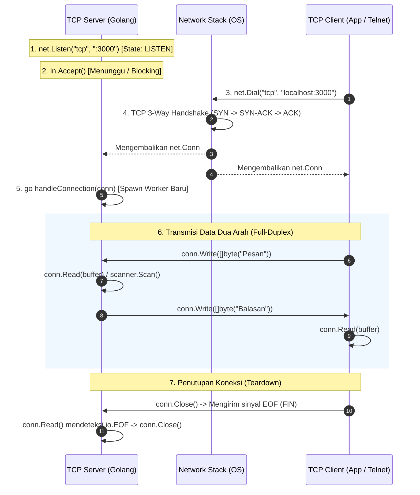

# 🌐 Panduan & Catatan Lengkap: Pemrograman TCP di Golang

Dokumen ini berisi rangkuman komprehensif mengenai konsep jaringan TCP, arsitektur *socket programming* di Golang, alur kerja (*lifecycle*), analisis *bug* umum, tantangan *stream framing*, serta contoh kode praktis (Server, Client, dan Log Ingestor SIEM).

---

## 📌 1. Fondasi & Karakteristik Protokol TCP

TCP (*Transmission Control Protocol*) beroperasi pada **Transport Layer (Layer 4 OSI)** dengan karakteristik utama:
1. **Connection-Oriented:** Memerlukan proses jabat tangan (*3-Way Handshake: SYN $\rightarrow$ SYN-ACK $\rightarrow$ ACK*) sebelum data dapat dikirim.
2. **Reliable & Ordered:** Paket data dijamin sampai tanpa kerusakan dan sesuai urutan pengiriman.
3. **Full-Duplex:** Client dan server dapat saling mengirim dan menerima data secara bersamaan dalam satu koneksi terbuka.
4. **Stream-Oriented (Byte Stream):** TCP tidak mengenal batasan pesan (*message boundary*), melainkan mengalirkan byte data secara kontinu (`[]byte`).

### ⚡ Mengapa Golang Sangat Unggul untuk TCP?
* **Ringan (*Lightweight Goroutines*):** Di bahasa konvensional (C++/Java), 1 thread OS per koneksi memakan RAM 1–2 MB. Di Golang, 1 goroutine hanya membutuhkan memori awal **~2 KB**.
* **Netpoller OS Abstraction:** Golang secara internal memanfaatkan *I/O multiplexing* non-blocking tingkat rendah (`epoll` di Linux, `kqueue` di macOS, `IOCP` di Windows) tetapi membungkusnya dalam kode sinkronis yang bersih dan mudah dibaca.
* **Skalabilitas Tinggi:** Sebuah server Go sederhana dapat menangani **100.000+ koneksi TCP konkuren** dengan konsumsi RAM di bawah 300 MB.

---

## 🔄 2. Alur Kerja (Workflow) TCP Server & Client



---

## 🚨 3. Analisis Bug Umum pada TCP Server Golang

Berikut adalah kesalahan umum saat membangun TCP Server dari nol:

### ❌ Masalah 1: *Race Condition* & *Nil Pointer Dereference*
```go
// SALAH:
go s.acceptLoop() // Goroutine dijalankan DULUAN
s.ln = ln         // s.ln baru di-assign setelahnya

// BENAR:
s.ln = ln         // Assign dulu listener ke struct
go s.acceptLoop() // Baru jalankan goroutine
```
* **Dampak:** Jika goroutine memanggil `s.ln.Accept()` sebelum `s.ln` terisi, program akan **panic / crash (`nil pointer dereference`)**.

---

### ❌ Masalah 2: *Infinite Loop* & CPU 100% saat Client Disconnect
```go
// SALAH:
n, err := conn.Read(buf)
if err != nil {
    fmt.Println("Read error:", err)
    continue // ⚠️ SANGAT BERBAHAYA! Saat client close, error adalah io.EOF
}

// BENAR:
n, err := conn.Read(buf)
if err != nil {
    // Keluar dari loop dan biarkan defer conn.Close() berjalan
    return 
}
```
* **Dampak:** Ketika koneksi diputus, `conn.Read()` menghasilkan `io.EOF` tanpa jeda. Penggunaan `continue` membuat CPU berputar jutaan kali per detik (**CPU 100%**).

---

## 🧩 4. Mengatasi Masalah *Framing* (Stream vs Message)

Karena TCP adalah aliran byte kontinu (*stream*), dua pesan yang dikirim berurutan bisa bergabung menjadi satu (*Packet Coalescing*).

### Solusi Terbaik di Golang:
1. **Delimiter-based (`\n` Newline):** Setiap pesan dipisahkan karakter ganti baris. Sangat cocok menggunakan library standar **`bufio.NewScanner`**.
2. **Length-prefixed:** 4 byte pertama menentukan panjang payload data (umum pada protokol biner).

---

## 💻 5. Contoh Implementasi Lengkap

### 🔹 Contoh A: TCP Server Modern dengan `bufio.Scanner` (Echo Server)
File: `server.go`

```go
package main

import (
	"bufio"
	"fmt"
	"net"
	"strings"
)

func main() {
	ln, err := net.Listen("tcp", ":3000")
	if err != nil {
		panic(err)
	}
	defer ln.Close()
	fmt.Println("🚀 TCP Server berjalan di port :3000...")

	for {
		conn, err := ln.Accept()
		if err != nil {
			fmt.Println("Gagal menerima koneksi:", err)
			continue
		}

		// Handle client secara konkuren
		go handleClient(conn)
	}
}

func handleClient(conn net.Conn) {
	defer conn.Close()
	remoteAddr := conn.RemoteAddr().String()
	fmt.Printf("✅ Client terhubung: %s\n", remoteAddr)

	scanner := bufio.NewScanner(conn)
	for scanner.Scan() {
		text := scanner.Text()
		fmt.Printf("[%s]: %s\n", remoteAddr, text)

		// Kirim balasan echo
		response := fmt.Sprintf("ECHO: %s\n", strings.ToUpper(text))
		conn.Write([]byte(response))
	}

	if err := scanner.Err(); err != nil {
		fmt.Printf("❌ Error: %v\n", err)
	}
	fmt.Printf("🔌 Client terputus: %s\n", remoteAddr)
}
```

---

### 🔹 Contoh B: TCP Client di Golang
File: `client.go`

```go
package main

import (
	"bufio"
	"fmt"
	"net"
	"time"
)

func main() {
	conn, err := net.Dial("tcp", "localhost:3000")
	if err != nil {
		panic(err)
	}
	defer conn.Close()
	fmt.Println("Berhasil terhubung ke server TCP!")

	messages := []string{"halo server", "testing pesan kedua", "ping"}
	reader := bufio.NewReader(conn)

	for _, msg := range messages {
		fmt.Printf("📤 Mengirim: %s\n", msg)
		fmt.Fprintf(conn, "%s\n", msg) // Menulis pesan + newline '\n'

		// Membaca balasan dari server
		reply, err := reader.ReadString('\n')
		if err != nil {
			fmt.Println("Koneksi ditutup oleh server")
			break
		}
		fmt.Printf("📥 Balasan Server: %s", reply)
		time.Sleep(1 * time.Second)
	}
}
```

---

### 🔹 Contoh C: TCP Log Ingestor (Relevan untuk SIEM / Tugas Akhir)
Menerima log stream berformat JSON per baris (*NDJSON*) dari agent keamanan:

```go
package main

import (
	"bufio"
	"encoding/json"
	"fmt"
	"net"
)

// Model Log Keamanan
type SecurityLog struct {
	Timestamp string `json:"timestamp"`
	SourceIP  string `json:"source_ip"`
	Username  string `json:"username"`
	Event     string `json:"event"`
}

func main() {
	logQueue := make(chan SecurityLog, 1000)

	// Worker SIEM Engine (Consumer Pipeline)
	go func() {
		for log := range logQueue {
			fmt.Printf("🛡️ [SIEM] Deteksi Log dari IP=%s | User=%s | Event=%s\n",
				log.SourceIP, log.Username, log.Event)
		}
	}()

	ln, err := net.Listen("tcp", ":5000")
	if err != nil {
		panic(err)
	}
	defer ln.Close()
	fmt.Println("🛡️ SIEM Log Receiver siap di port :5000...")

	for {
		conn, err := ln.Accept()
		if err != nil {
			continue
		}
		go handleLogIngest(conn, logQueue)
	}
}

func handleLogIngest(conn net.Conn, queue chan<- SecurityLog) {
	defer conn.Close()
	scanner := bufio.NewScanner(conn)

	for scanner.Scan() {
		var entry SecurityLog
		if err := json.Unmarshal(scanner.Bytes(), &entry); err != nil {
			fmt.Println("⚠️ Format bukan JSON:", scanner.Text())
			continue
		}
		// Masukkan log ke pipeline analisis SIEM
		queue <- entry
	}
}
```

---

## 🧪 6. Panduan Pengujian di Terminal Windows

### 1. Menggunakan Telnet
```powershell
telnet localhost 3000
```
> *Jika command telnet tidak ditemukan di Windows, aktifkan via PowerShell Administrator:*
> `Enable-WindowsOptionalFeature -Online -FeatureName TelnetClient`

### 2. Menggunakan Netcat / Ncat
```powershell
nc localhost 3000
# atau
ncat localhost 3000
```

### 3. Menggunakan PowerShell Langsung (Tanpa Install Apapun)
```powershell
$client = New-Object System.Net.Sockets.TcpClient("127.0.0.1", 3000); $stream = $client.GetStream(); $writer = New-Object System.IO.StreamWriter($stream); $writer.WriteLine("Tes dari PowerShell"); $writer.Flush(); $client.Close()
```

---

## 🎓 7. Relevansi Akademis untuk Tugas Akhir (TA)

| Komponen | Pakai Library / Bawaan | Buat Sendiri (Nilai Novelty TA) |
| :--- | :--- | :--- |
| **Transport Layer** | `net` / `net/http` bawaan Go | - |
| **YAML Parser** | `gopkg.in/yaml.v3` | - |
| **Log Collector Pipeline** | - | **Goroutine Worker Pool & Channels** |
| **Rule Matcher** | - | **Sigma Rule Evaluator** |
| **Correlation Engine** | - | **Sliding Window In-Memory Algorithm** |

